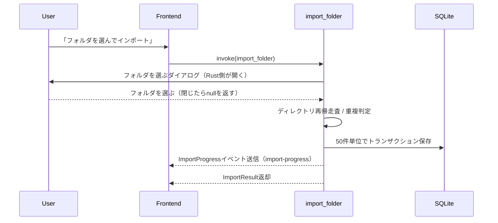
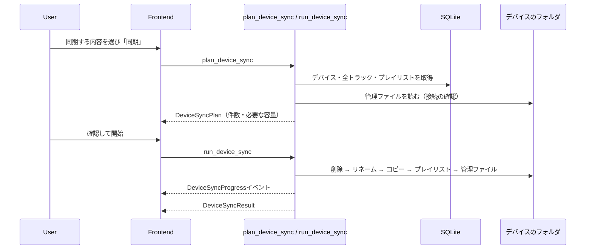

# 設計概要: アーキテクチャ・データフロー

## 全体アーキテクチャ

```mermaid
graph TD
    U[User] --> FE[SvelteKit UI]
    FE --> STORES[共有状態 stores]
    FE --> QUERY[TanStack Query]
    QUERY --> INVOKE[@tauri-apps/api/core invoke]
    INVOKE --> CMD[Rust Commands]
    CMD --> REPO[repository / playlist / library / metadata]
    REPO --> DB[(SQLite + FTS5)]
    REPO --> FS[(ローカル音楽ファイル)]
    CMD --> EVT[Tauri Event Emitter]
    EVT --> FE
```

## レイヤー責務

| レイヤー                  | 主な実装                                                    | 責務                                               |
| ------------------------- | ----------------------------------------------------------- | -------------------------------------------------- |
| UI                        | `src/routes`, `src/lib/components`                          | 画面描画、ユーザー操作の受付                       |
| クライアント状態          | `src/lib/stores`                                            | 再生状態・UI状態など即時反映が必要な状態管理       |
| サーバー状態キャッシュ    | `src/lib/queries`                                           | `invoke`呼び出し、キャッシュ、再取得制御           |
| コマンド層                | `src-tauri/src/commands/*`                                  | 入力バリデーション、ユースケース単位の操作公開     |
| ドメイン/データアクセス層 | `repository.rs`, `library.rs`, `playlist.rs`, `metadata.rs` | SQL実行、ファイル走査、タグ読み書き                |
| 永続化                    | SQLite, ローカルファイル                                    | トラック/プレイリスト/統計の保存、音楽ファイル実体 |

## フロントエンド構成

- ルート: `src/routes/(app)` 配下にライブラリ・プレイリスト・転送先デバイス（`devices/[id]`）、`src/routes/settings` に設定画面（メニューから開く別ウィンドウ。独自のQueryClientを持つ）
- 設定: Rust側（`settings.rs`）がアプリデータ配下の`settings.json`に保存する。設定ウィンドウで保存するとRustが`SettingsChanged`イベントを送り、メインウィンドウの`SettingsSync`がキャッシュ・テーマ・アクセントカラー（CSS変数`--color-primary`）を更新する
- ウィンドウの状態: メインウィンドウのサイズ・位置・最大化・フルスクリーンは、`tauri-plugin-window-state`が終了時にアプリの設定フォルダの`.window-state.json`へ保存し、次回の起動時に復元する（`lib.rs`の`window_state_plugin()`）。記憶がない初回は`tauri.conf.json`の大きさ（1280×800）で開く。設定ウィンドウは対象外で、毎回同じ大きさ（900×680。`menu.rs`の`SETTINGS_WINDOW_SIZE`）で開く
- ウィンドウの外からの操作: 設定でオンにすると、メニューバー（トレイ）に常駐し（`tray.rs`。ウィンドウを閉じても、隠すだけで再生を続ける）、グローバルホットキー（`global_shortcuts.rs`）で再生を操作でき、曲が変わった時にOSの通知を出す（`track_notification.rs`）。ミニプレーヤーは、メインウィンドウを小さな表示に切り替える（`mini_player.rs`と`MiniPlayer`）。再生キューはフロントエンドが持つため、どの操作も`PlaybackControl`イベントでフロントエンドへ送り、ウィンドウを隠している間もWebViewを動かし続ける（ADR-046）
- 多言語化: 画面の文言は`src/lib/i18n/messages`（日本語・英語）に定義し、`#lib/i18n/i18n.svelte`の`m`から読む。言語は`$state`のため、切り替えるとコンポーネントを作り直さずに文言が変わる（再生は止まらない）。メニューバーと設定ウィンドウのタイトルはRust側（`menu.rs`）が言語に合わせて作り直す
- テーマ: `#lib/utils/theme`の`applyTheme`が`<html data-theme>`に`dark`・`light`を設定し、`app.css`の配色を切り替える。「OSの設定に従う」の間は`prefers-color-scheme`の変化に追従する。設定を読み込むまでの間は、前回のテーマ（`localStorage`）を`restoreTheme`で反映する
- 起動時の画面: ルート（`/`）が設定に応じて、前回開いていた画面（`localStorage`に記録）か曲一覧へ移動する
- UI部品: `src/lib/components` と `src/lib/components/ui`（共通の部品。メニューは、Bits UIのメニューを包んだ`BaseContextMenu`と`Menu*`。ボタンから開くパネルは`Popover`、タブは`Tabs`と`TabPanel`で、どれもBits UIを包んだもの。ADR-056）
- 型: `src/lib/types/models.ts` をRustモデルと対応させる
- データ取得: `src/lib/queries/*.ts` のクエリ・ミューテーションがコマンド呼び出し・キャッシュ無効化・エラー通知を担い、コンポーネントからは直接コマンドを呼ばない
- 曲の一覧: 全曲の一覧は件数の上限なく1回で取得してキャッシュし、並び替え・選択・再生キューの作成はフロントで行う。アルバム・アーティストはアルバムアーティスト（なければ曲のアーティスト）でまとめる（ADR-022）。アルバム・アーティスト・ジャンルは一覧（曲数・代表の曲）だけを取得し、曲は詳細を開いた時・再生する時にその分だけ取得する。プレイリストの曲も、プレイリストごとに取得する（ADR-021）。自動プレイリストの曲は、開くたびに条件から求め直す（ADR-042）。名前の順の並びは、クエリが取得した後に`#lib/utils/nameSort`で並べ直す（並び順に使う値（読み仮名など）があればその値で、言語に合わせた比較で並べる。ADR-036）
- 再生履歴: 再生した日時とトラックIDの一覧（`get_play_history`）を、全曲の一覧のキャッシュと突き合わせて、日付ごとに表示する（`PlayHistoryList.svelte`。同じ曲が何度も出るため、行は履歴の1件ごとに見分ける。ADR-030）
- 曲の一覧: `TrackList.svelte` が、全曲・お気に入り・よく再生する曲・ジャンルの曲・プレイリストの曲の一覧を表示する（プレイリストは、プレイリストの順で並べている間だけ、行のドラッグで並べ替えられる。ADR-039）。リスト表示の列は選べ（見出しの右クリック）、見出しのドラッグで入れ替え、どの列でも並べ替えられる。列と並び順は、画面ごとに覚える（ADR-038）。プレーヤーの曲名のクリック（Ctrl+L）で、再生中の曲の行へ移動する
- ライブラリのビュー: 最近追加した曲（アルバム単位・追加した日時の新しい順）・フォルダ別・年代別の画面は、取得済みの全曲の一覧からフロントエンドで集計して表示する（`#lib/utils/libraryViews`。ADR-041）。サイドバーの項目は、設定（`hiddenSidebarItems`）で隠せる
- 重複した曲: タイトルとアーティストが同じ（検索と同じ規則でそろえて比べる）で、長さの違いが3秒までの曲を、取得済みの全曲の一覧からフロントエンドでまとめて表示する（`#lib/utils/duplicates`。ADR-052）。一覧は`TrackList`で、まとまりの間に線を引く（`groupOf`）。どの曲を残すかは、利用者が決める（曲のメニュー・Deleteキーから削除する）
- ライブラリの絞り込み: 曲の画面は、検索・フィルタ（評価・年・お気に入り）・カラムブラウザ（ジャンル → アーティスト → アルバム）のすべてに合う曲を出す。絞り込みは、取得済みの曲の一覧（検索している間は、検索の結果）に対してフロントエンドで行う（`#lib/utils/trackFilter`。ADR-040）
- 右サイドバー: 再生キュー・イコライザ・情報パネルを切り替えて表示する（`RightSidebar.svelte`）。情報パネル（`InfoPanel.svelte`）は、グリッド（アルバム・アーティスト・最近追加した曲）で選んだ項目と、曲の一覧（`TrackList`）で選んだ曲のアルバム（`ui.infoTarget`）の曲を表示する。曲の一覧の選択は、パネルを開いている間だけ反映し（自動では開かない）、最後に選んだ曲のアルバムを出して、パネルの一覧の中でもその曲を選ぶ。アルバムのない曲は、曲だけを出す（ADR-066）。曲は、パネルが項目の名前で取得する（アルバムは`get_album_tracks`、アーティストは`get_artist_albums`）。情報パネルは固定の状態にかかわらず本文の横に並べ、キュー・イコライザは固定した時だけ並べる（並べない時は本文に重ねる。ADR-063）
- 長い一覧の描画: `src/lib/components/ui/VirtualList.svelte` が、見えている行（とその前後の少しの行）だけを描画する（`implementation.md` 参照）
- アルバムアート: `#lib/utils/albumArt` の `albumArtUrl(trackId)` が返す `albumart://` のURLを `` に指定し、Rust側のカスタムプロトコルから直接読み込む（フロントエンドに画像データを保持しない）。アルバムアートの画面（`AlbumArtDialog.svelte`。曲・アルバムの右クリックのメニューと、アルバムの画面・情報パネルの絵から開く）で画像を埋め込む・取り除くと、その曲の版（`#lib/stores/albumArt.svelte`）を進めてURLを変え、表示中の画像を読み直させる（ADR-035）
- 再生: 再生コントローラー（`src/lib/stores/playback.svelte.ts`）が、再生状態（`player.svelte.ts` の `player`）を `$effect` で監視してRust側の再生エンジン（`src-tauri/src/playback/`）をコマンドで操作し、エンジンからの通知（`PlaybackEvent`。再生位置・曲の切り替わり・終了）を再生状態へ反映する。`Player.svelte` は表示と操作の受付に専念する
  - 再生キュー（次の曲の決定・シャッフル・リピート）は、フロントエンド（`player.svelte.ts`）が持つ。エンジンへは「再生する曲」と「続けて再生する曲」だけを伝える（ADR-025）
  - 再生キューには同じ曲を何度でも入れられる。キューの要素（`#lib/utils/playQueue`の`QueueEntry`）は、曲と、要素ごとに一意なID（エントリID）を持ち、「次に再生」の一覧のキー・削除・並べ替え・シャッフルの切り替えは、曲のIDではなくエントリIDか位置で行う。シャッフル中は、キューへの追加・削除をシャッフルする前の順（`originalQueue`）にも行い、解除するとその順の、再生中の要素の位置へ戻る（その順に再生中の要素がなければ、再生中の位置へ入れる）。エントリIDは保存せず、復元する時に振り直す（ADR-059）
  - イコライザ・音量の正規化・クロスフェードは、エンジンの中でかける（ADR-026）。イコライザの設定はフロントエンドが保存し（`equalizer.svelte.ts`。localStorage）、再生コントローラーがエンジンへ送る
  - WebViewは音声ファイルを読まない（audio要素・Web Audioは使わない。ADR-027）
  - Now Playingの画面: 再生中の曲を大きく表示し、歌詞を出す（`NowPlayingView`。ページの領域に重ねる）。歌詞は、Rust側（`lyrics.rs`）が曲のIDからファイルを探して読み（曲と同じ名前の`.lrc`ファイルを優先し、なければ埋め込みの歌詞）、フロントエンドが時刻を解釈して、再生位置の行を強調する。外部からは取得しない（ADR-045）
  - 再生の補助: 「この曲が終わったら停止」・スリープタイマー・Auto DJは、フロントエンドの再生コントローラーとキューで行う（エンジンには、今あるコマンド（次の曲の取り消し・音量・一時停止）だけを使う）。Auto DJは、キューの最後の曲になったら、ライブラリか選んだプレイリストから曲を足す（ADR-044）。再生速度は、フロントエンドが持つ値（`playbackAids.speed`。保存しない）を、起動時と変更のたびにエンジンへ送る（ADR-049）
  - 再生状態の保存と復元: 音量・シャッフル・リピート・再生キュー・再生していた曲を、Rust側（`playback_state.rs`）がアプリデータ配下の`playback-state.json`に保存する。再生コントローラーが、起動時に復元し（再生は始めない）、その後の変更をまとめて保存する（`playbackState.svelte.ts`。ADR-028）。キューは変わった時だけ送り、キューを送った保存が済むまでは（失敗した場合も）、次の保存でもキューを送る（再生していた曲の位置だけが、保存してあるキューと食い違わないように）
  - 再生回数・スキップ回数（ADR-030）: 再生コントローラーが、実際に鳴らした時間を数え（`playTracker.ts`）、曲の半分か4分を聴いた時に再生回数（と再生履歴）へ、数える前に別の曲へ移った時にスキップ回数へ記録する
  - OSのメディアキー・Now Playing（ADR-029）: 再生コントローラーが、プレーヤーバーと同じ内容（曲・再生中かどうか・再生位置）を`set_now_playing`でRust側へ伝える（`nowPlaying.ts`が、伝え直すかどうかを決める）。OSからの操作と、メニューバーの「再生」メニューは、`PlaybackControl`イベントで届き、`Player.svelte`がウィンドウの中のキー操作と同じ処理を行う
- ダイアログ: `src/lib/components/ui/Modal.svelte`（ネイティブの`<dialog>`）に統一。テキスト入力は`promptText()`の要求を、レイアウトに置いた`TextPromptDialog`が表示する
- ブラウザ確認用モック: `npm run dev:mock` のときだけ `src/hooks.client.ts` が `src/lib/mocks` のインメモリバックエンドへIPCを差し替える（`implementation.md` 参照）

## バックエンド構成

- エントリーポイント: `src-tauri/src/lib.rs`
- アプリ状態: `AppState { db: Mutex<Connection>, current_track_id: Mutex<Option<String>>, album_art_limiter: Semaphore, album_art_cache: Mutex<AlbumArtCache>, library_scan_lock: Mutex<()> }`。ほかに設定（`SettingsState`）・前回の再生状態（`PlaybackStateStore`）・再生エンジン（`PlaybackEngine`）・OSのメディアキー / Now Playing（`MediaControls`）・ライブラリフォルダの自動反映（`LibrarySync`）を管理する
- 既存のトラックの、後から追加した項目の読み込み: `tag_backfill.rs` が、アルバムアーティスト・ソート用のタグの列を追加する前に登録したトラックの分と、複数の値に対応する前に最初の値だけを読んだアーティスト・ジャンルを、起動時に別スレッドでファイルのタグから読み込む（対象がなければ何もしない。ADR-022・ADR-036・ADR-051）
- 複数の値を持つ項目（アーティスト・ジャンル）: データベースには、値を`; `でつないだ文字列で持つ（表示・検索・並べ替えはそのまま使う）。一覧の集計と絞り込みの時に、値に分ける（Rust側は`multi_value.rs`と、そのSQLの関数。フロントエンドは`#lib/utils/multiValue`。ADR-051）
- ライブラリフォルダの自動反映: `library_sync.rs` が、設定に応じて起動時・定期（専用スレッド）・フォルダの監視（`notify-debouncer-mini`）で再スキャンする。インポート・再スキャン・ライブラリフォルダの削除・音楽フォルダの設定は`library_scan_lock`で1つずつ行い、ロックの順序は「スキャン → DB」。ファイルの整理・ファイルへのタグの書き出し・ファイルからのメタデータの読み直し（`refresh_library_metadata`）も、同じロックを取って再スキャンと重ならないようにする
- アルバムアートの配信: `album_art.rs` が `albumart` カスタムプロトコルを処理する。トラックIDからDB上のファイルを引いて、埋め込みの画像（なければ、同じフォルダの`cover.jpg`・`folder.jpg`などの画像）をバイト列のまま返し、結果（アートがないことを含む）は容量上限付きのLRUキャッシュ（64MiB）に保持する。フォルダの画像・アートなしのキャッシュは、参照する時にフォルダと画像の更新日時を確かめ、変わっていれば読み直す（アプリの外で画像が置かれる・差し替えられるため）。WebViewには`no-store`でキャッシュさせず、インポート・再スキャン・ファイルの整理・メタデータの読み直しの後はキャッシュを消去し、アプリで画像を書き換えた曲はキャッシュから捨てる（ADR-035）
- 重い同期処理（インポート、メタデータ再読込、ファイルへのタグ書き込み、アルバムアート抽出、ファイル削除）は `run_blocking`（`spawn_blocking`）でブロッキング処理用スレッドへ逃がし、非同期ランタイムのワーカーを占有しない。アルバムアート抽出はセマフォで同時実行数を4に制限する
- 曲とファイルの削除は、DBのロックの中でパスを求め、ロックの外でファイルを消し（macOSではゴミ箱へ移す）、消せた曲の行だけを短いトランザクションで削除する（ADR-061）。DBは、開く時に外部キーを有効にする（`db::setup_connection`）
- バックエンド→フロントエンドの通知は `events.rs` の型付きイベント（tauri-specta）で行い、フロントは `bindings.ts` の `events.xxx.listen()` で受け取る
- デバイスへの転送: `device.rs`（デバイスの記録）・`device_manifest.rs`（デバイス側の管理ファイル）・`device_sync.rs`（配置と差分の計算。ファイルシステムに触れない）・`device_transfer.rs`（削除・リネーム・コピー・プレイリストの書き出し）に分ける。同時に実行する同期は1つ（`DeviceSyncState`）で、DBロックは曲・プレイリストの読み出しの間だけ持つ（コピー中は持たない）
- 再生エンジン: `playback/`。エンジンのスレッド（`engine.rs`）がコマンドを順に処理しながら、デコード（`decoder.rs`。`symphonia`とlibopus。WavPack・APEは、ブロックごとにデコードする専用のデコーダー（`block_decoder.rs`・`wavpack.rs`・`ape.rs`。ADR-047。WavPackはブロックをファイルから順に読む。ADR-064）） → 出力の形式への変換（`convert.rs`。ステレオ・出力デバイスのサンプルレート。`rubato`） → 音量の正規化（`normalization.rs`。曲ごとの倍率） → クロスフェード（2曲を重ねる） → リングバッファへの書き込みを行う。出力のコールバック（`render.rs`。`cpal`が呼ぶOSの音声のスレッド）は、リングバッファから取り出して、再生速度（`stretch.rs`。音程を保ったまま長さを変える時間伸縮。1倍の間は通さない） → イコライザ → 音量・一時停止 → リミッター（`effects.rs`）の順にかけるだけで、ロック・メモリの確保・ファイルの読み取りをしない。出力は最初に再生する時に開き、再生していない間は止める（ADR-025・ADR-026）。続けて再生する曲のデコーダーは、別のスレッドで開き、開き終えたらコマンドでエンジンへ渡す（開くのに時間がかかっても、再生中の曲のデコードを止めない。ADR-064）
- ほかのプレーヤーからの取り込み: `library_xml.rs`が、iTunes形式のライブラリXMLから再生回数・追加日・最終再生日・お気に入り・プレイリストを読む。曲の突き合わせは`m3u.rs`の`TrackMatcher`を使い、値は多い方（日時は新しい方・古い方）を採る（ADR-033）
- プレイリストの整理: プレイリストは、1階層のフォルダ（`playlist_folders`）に分けられる。並び順（名前・作成日・手動）はフロントエンドが選び、手動の順だけをDB（`position`）に持つ。サイドバー（`SidebarPlaylists`）とプレイリストの一覧の画面は、同じ並びで表示する（ADR-043）
- 自動プレイリスト: `smart_playlist.rs`が、条件（項目・比べ方・値の組の一覧と、組み合わせ方・並び順・曲数の上限）の検証と、条件に合う曲の取得を担う。条件は`playlists.rules`にJSONで保存し、曲は開くたび・転送するたびに条件から求める（曲の一覧は保存しない）。条件の編集はフロントエンド（`SmartPlaylistDialog`）で行い、合う曲はバックエンドがSQLで求める（ADR-042）
- プレイリストのM3U: `m3u.rs`が、読み込み（文字コードの判定・曲の場所とライブラリの曲の対応付け）と書き出し（拡張M3U）を担う。ファイルの選択は、コマンド（`commands/m3u.rs`）がRust側でダイアログを開いて行い、WebViewからパスを受け取らない（ADR-032）
- OSのメディアキー・Now Playing: `media_controls/`。`set_now_playing`で届いた曲のIDから、曲の情報とアルバムアート（`album_art.rs`のキャッシュ）を読んでOSへ渡し、OSからの操作を`PlaybackControl`イベントでフロントエンドへ送る。macOSだけに対応し（`macos.rs`。MediaPlayerフレームワーク）、ほかのOSでは何もしない。MediaPlayerのオブジェクトはメインスレッドだけで扱う（ADR-029）
- メニューバー: `menu.rs`（設定の言語に合わせる）。「再生」メニューの項目は、`PlaybackControl`イベントを送る（キーは割り当てない）
- コマンド登録: `tauri::generate_handler!` でインポート/検索/編集/再生/統計/システム操作を公開
- DB初期化: `db.rs` のマイグレーションでテーブル・インデックス・FTS5・トリガーを作成

## 主要データフロー

### インポート



インポートしたフォルダは `library_folders` に記録する（ライブラリフォルダ）。フォルダの走査（インポート・再スキャン）とフォルダの監視は、隠しフォルダ・ゴミ箱・パッケージと、ライブラリフォルダごとの読み込まないフォルダ（`library_folder_exclusions`）の中を読まない（ADR-062）。

インポートの始め方は4つあり、どれも同じ処理（`commands/import.rs`の`import_and_notify`）で曲を登録する（ADR-050）。フォルダは中の曲を登録してライブラリフォルダとして記録し、ファイルは曲だけを登録する（フォルダは記録しない）。

- フォルダを選ぶ（`import_folder`）・ファイルを選ぶ（`import_files`）: インポートダイアログから。フォルダ・ファイルを選ぶダイアログは、Rust側が開く（WebViewからパスを受け取らない。ADR-065）
- ウィンドウへドロップする（`import_dropped_files`。macOS）: `FileDropZone`がドロップを受け取り、名前だけをRust側へ伝える。パスは、Rust側（`dropped_files.rs`）がOSのドラッグ用のペーストボードから読む（Tauriのファイルドロップは使えない。ADR-018）
- Finderの「このアプリで開く」・Dockのアイコンへのドロップ（ファイルの関連付け。`opened_files.rs`）: Rust側がインポートしてから`TracksOpened`で知らせ、フロントエンドが`take_opened_files`で曲を受け取って再生する

進み具合と結果は、どの始め方でもインポートダイアログに表示する（実行と状態は`importer`ストアが持つ）。

#### 音楽フォルダへのコピー

音楽フォルダを設定し、設定「取り込む曲を音楽フォルダへコピーする」（`copyToMusicFolder`。既定はオン）がオンの時は、取り込む曲を音楽フォルダへ書式どおりにコピーしてから、コピー先の曲を登録する（`music_folder_copy.rs`。元のファイルは残す。ADR-069）。

1. ファイル（選ぶ・ドロップ・「このアプリで開く」）は、設定に従ってコピーする。「このアプリで開く」では、コピー先の曲を再生する
2. ライブラリフォルダの外のフォルダを取り込む時（選ぶ・ドロップ）は、Rust側がフォルダを走査して預かり（`PendingImport`）、曲の数・大きさと音楽フォルダの空き容量を`chooseFolderMode`で返す。インポートダイアログが「今の場所のまま参照する」か「音楽フォルダへコピーする」かを選ばせ、`import_pending_folders`で取り込む（閉じたら`cancel_pending_import`）。コピーした時は、元のフォルダをライブラリフォルダとして記録しない
3. `lock_library_scan`の中で、ライブラリにある曲（登録済み・ライブラリフォルダの中）は参照して登録し、ほかの曲は読んでコピー先を決め（計画）、空き容量を確かめてから、コピーして50件ずつ登録する（`ImportProgress`の`phase`が`reading` → `copying`）
4. 音楽フォルダが見つからない・空き容量が足りない場合は、何も取り込まずに理由を返す（黙って参照に切り替えない）。コピー先に同じ名前のファイルがある曲・同じコピー先になる曲は、取り込まずに結果（`notCopied`）で知らせる

### 音楽フォルダ

ライブラリフォルダの1つに「音楽フォルダ」（新しい曲を置く宛先）の印を付けられる（`library_folders.is_music_folder`。多くても1つで、設定しなくてもよい。ADR-068）。ほかのライブラリフォルダは、今どおりその場の参照。音楽フォルダの書式（置き方）は設定（`settings.json`の`musicFolderTemplate`）に持つ。

1. 入口は2か所: ライブラリが空の画面（曲の画面の`MusicFolderSetup`）と、設定の「ライブラリ」（`MusicFolderSettings`）。どちらも「OSの音楽フォルダを使う」（パスはRust側が`audio_dir`で求める）か「フォルダを選ぶ...」（Rust側のダイアログを、呼び出したウィンドウの上に出す）で`set_music_folder`を呼ぶ
2. Rust側（`commands/music_folder.rs`）は、`lock_library_scan`の中で、選んだフォルダが登録済みのライブラリフォルダなら印を移すだけ、その中のフォルダなら外側のフォルダを返し（音楽フォルダにはしない）、それ以外は空でもライブラリフォルダとして登録して中の曲を読み込み（`import_folder`と同じ処理。`ImportProgress`を送る）、印を付ける
3. `LibraryChanged`を送り、メインウィンドウ（曲の一覧と空の画面）と設定ウィンドウ（ライブラリフォルダの一覧と音楽フォルダ）が読み直す。メインウィンドウでは、曲を読み込んだ場合だけインポートダイアログに進み具合と結果を出す（`importer.setMusicFolder`）
4. 音楽フォルダを変えても、ファイルは動かさない。音楽フォルダのライブラリフォルダを削除すると、印も消えて未設定に戻る。音楽フォルダを含むフォルダをインポートして記録をまとめた場合は、外側のフォルダに印を移す
5. 書式は、設定の「ライブラリ」で、ほかの設定と同じく「適用」で保存する（`MusicFolderTemplateSetting`）。入力が止まると、最近追加したアルバムの曲を当てはめた例を`preview_music_folder_template`で取り直す（置き方の決まりは、ファイルの整理と同じ`file_organize::Template`）。取り込む曲は、この書式で音楽フォルダへコピーする（上の「音楽フォルダへのコピー」）

### ライブラリフォルダの再スキャン

1. 設定ウィンドウの「ライブラリ」で再スキャンを実行する（`rescan_library_folder`）
2. フォルダを走査し、ライブラリのトラックとサイズ・更新日時を比べる（`library_folder::plan_rescan`）
   - ライブラリにないファイルは追加、サイズか更新日時が変わったファイルは読み直す（変わっていないファイルは読まない。アプリからの編集は、書き込み後のサイズ・更新日時を記録するため変更とみなさない）
   - 見つからなくなったファイルの曲は、外さずに「見つからない曲」として残す（お気に入り・再生回数・プレイリストを保つ）。ただしフォルダ自体が見つからない、または音楽ファイルが1件も見つからない場合は、見つからない曲にもしない
3. 読み込みはインポートと同じく、DBロックの外でメタデータを抽出し、50件単位で書き込む（`LibraryScanProgress`イベントで進捗を送る）
   - ライブラリにないファイルが、見つからない曲の移動・改名の先と判定できた場合（`track_relink`）は、新しい曲として追加せず、その曲のパスを付け替える（ADR-023）
4. 曲が変わったら`LibraryChanged`イベントを送り、メインウィンドウ（`(app)/+layout.svelte`）がトラック一覧とプレイリストのキャッシュを無効化する

### ライブラリフォルダの場所の付け替え

1. 設定ウィンドウの「ライブラリ」で「場所を変更...」を押すと、`plan_library_folder_relocation`がRust側のダイアログで新しい場所を選ばせる
2. Rust側は、今の場所・ほかのライブラリフォルダ・転送先デバイスと重ならないこと、付け替えた曲のパスがほかの曲と同じにならないことを確かめ、新しい場所でファイルが見つかる曲を数える。付け替えられる場所は預かり（`PendingRelocation`）、`LibraryFolderRelocationDialog`が件数を見せて確かめる（付け替えられない場所は、理由をトーストで知らせる）
3. 「付け替える」で`relocate_library_folder`を呼ぶ。`lock_library_scan`の中で場所を確かめ直し、記録のパスと中の曲のパスの先頭を1つのトランザクションで書き換える（トラックのIDは変えない。ADR-072）
4. 監視するフォルダを更新して`LibraryChanged`を送り、新しい場所を再スキャンする（上の「ライブラリフォルダの再スキャン」と同じ。`LibraryScanProgress`で進み具合を出す）

### デバイスへの転送



1. サイドバーの「デバイス」でフォルダを選んで登録する（`register_sync_device`。フォルダを選ぶダイアログはRust側が開き、名前はドライブ・フォルダの名前にする）。フォルダに管理ファイル（`.muspice/manifest.json`）を書く
2. デバイスのページ（`(app)/devices/[id]`）で同期する内容（全曲・プレイリスト）を選ぶ。変更はすぐに保存する（`update_sync_device`）。接続の状態は、ページを開いている間は5秒ごとに、それ以外はウィンドウに戻ったときに読み直す
3. 「同期」で差分を調べて（`plan_device_sync`）確認のダイアログ（`DeviceSyncDialog`）に表示し、確認の後に同期する（`run_device_sync`）
4. 差分は、同期する曲・プレイリストと管理ファイルを比べて決める（`device_sync::plan_sync`）。詳細は`detailed-design.md`

### 再生

1. 再生するトラック（`player.currentTrack`）が変わると、再生コントローラーが`playback_play(trackId, token)`を呼ぶ。Rust側はトラックIDからファイルを解決し（パスはWebViewから受け取らない）、エンジンがファイルを開いて再生を始め、曲の長さを返す
2. ギャップレス再生が有効なら、キューの次の曲を`playback_set_next`で伝えておく（キュー・リピート・シャッフルが変わるたびに伝え直す）。エンジンは、その曲のファイルを別のスレッドで開き、開き終えたら続けて再生する曲として用意する（開いている間も、再生中の曲は途切れない）
3. エンジンは、再生位置を`PlaybackEvent`の`position`で一定の間隔（0.25秒）ごとに送る
4. 再生中の曲のデコードが終わると、エンジンは続けて再生する曲の音声を切れ目なく続けて書き、鳴っている曲が切り替わった時点で`advanced`を送る。フロントはキューを進め（再生し直さない）、その次の曲を伝える
5. 続けて再生する曲がなければ、鳴り終わった時点で`ended`が届く。フロントはキューを進めて次の曲を`playback_play`で再生する（次がなければ再生を終える）
6. 一時停止・シーク・音量は、それぞれのコマンドをエンジンへ送る。出力デバイス・音量の正規化・クロスフェードは設定に保存し、`save_settings`がエンジンへ伝える（出力デバイスが変わった場合は、再生中の曲を同じ位置から続ける）
7. クロスフェードが有効なら、エンジンは前の曲の終わりと次の曲の頭を重ねて書き、重なりが鳴り始めた時点で`advanced`を送る（4と同じく、フロントはキューを進めるだけ）
8. イコライザの設定（フロントエンドが保存している）は、再生コントローラーが起動時と変更のたびに`playback_set_equalizer`で送る

### 検索

1. フロントエンドで300msデバウンス
2. `search_tracks` 実行
3. バックエンドは検索語を正規化（大文字と小文字・全角と半角・ひらがなとカタカナをそろえる）して空白で区切り、3文字以上の語だけならFTS5（trigram）の索引で、3文字未満の語があれば`LIKE`の走査で、すべての語を含む曲を探す（ADR-003）
4. 結果をTanStack QueryでキャッシュしてUIへ反映

### 形式の変換

1. 曲のメニューの「形式を変換...」（macOSだけに出る）で、選んだ曲の画面（`ConvertDialog`）を開く。変換先の形式・出力先（書き出す / 置き換える）を選ぶたびに、`plan_conversion`で計画（曲ごとの出力先、変換しない曲と理由）を取り直して一覧にし、音質が戻らない変換（非可逆 → 可逆など）を知らせる
2. 「変換する」で`convert_tracks`を呼ぶ。書き出しでは、Rust側が書き出すフォルダを選ぶダイアログを開く
3. Rust側が、再生と同じデコーダーで曲を読み、macOSの`afconvert`でエンコードして、タグ・アルバムアートを写す（ADR-054）。曲の変換が済むたびに`ConvertProgress`を送る
4. 書き出しは、選んだフォルダへ書式に従って置く（ライブラリは変えない。加える指定があれば、曲だけ登録する）。置き換えは、変換したファイルを元の場所に置き、元のファイルをゴミ箱へ移して、DBの場所と形式を書き換える（トラックのIDは変えない）

### 音量の解析

1. 設定の「ライブラリ」の「音量の解析」（音量の情報が欠けている曲）か、曲のメニューの「音量を解析...」（選んだ曲を解析し直す）から、`start_loudness_scan`を呼ぶ
2. Rust側が、解析するまとまり（アルバムか、アルバムのない1曲）を決め、いくつかを並行して、再生と同じデコーダーで読んでラウドネスを測る（`loudness.rs`。ADR-053）。曲を読み終わるたびに`LoudnessScanProgress`を送る
3. まとまりごとに、曲とアルバムのゲイン・ピークをファイルのタグ（ReplayGain）へ書き込み、DBに記録する。中断（`cancel_loudness_scan`）すると、解析の途中のまとまりには書かずに終わる
4. 終わると`LoudnessScanFinished`と（書き込んだ場合は）`LibraryChanged`を送る。進み具合は、どちらのウィンドウでも見られる（`loudnessScan.svelte`）。次に再生する曲から、新しいゲインで音量をそろえる

### ファイルの整理

1. 曲のメニューの「ファイルを整理...」で、選んだ曲の画面（`FileOrganizeDialog`）を開く。音楽フォルダを設定していれば、移動先（曲のあるライブラリフォルダの中か、音楽フォルダへ集めるか）を選べる
2. 書式・移動先を変えるたびに、`plan_file_organize`で計画（今の場所 → 整理後の場所、動かせない曲と理由、別のドライブからコピーする曲の容量と空き容量）を取り直して、一覧にする（ファイルは動かさない）。音楽フォルダへ集める時は、設定の音楽フォルダの書式を使う
3. 「整理する」で`organize_files`を呼ぶ。Rust側が計画を立て直し、動かせる曲だけを移す（上書きしない。同じ名前の歌詞ファイル・フォルダごと移る場合のフォルダの画像も移し、空になったフォルダを消す）。別のドライブの曲は、コピーして確かめ、DBを書き換えてから元をゴミ箱へ移す（ADR-070）。DBは、場所だけを書き換える（トラックのIDは変えない。ADR-052）。曲ごとに`OrganizeProgress`を送り、画面は進み具合を出して、`cancel_file_organize`で中止できる
4. `LibraryChanged`で、一覧とプレイリストを取り直す。フォルダの監視による再スキャンは、整理が終わるまで待つ（終わった時には、DBとディスクが合っている）

### メタデータ編集

1. 入力値バリデーション（ID形式、文字数、年・トラック番号）
2. `update_track_metadata`（1曲）・`update_multiple_tracks_metadata`（一括）・`apply_metadata_changes`（タグの一括ツール。曲ごとに違う値）で、ファイルのタグへ書き込み、同じ内容をDBに記録する（ADR-019）。評価（`set_rating`）も同じ
3. 設定「音楽フォルダを整理された状態に保つ」がオンなら、タグを保存できた音楽フォルダの中の曲を、ファイルの整理（音楽フォルダへ集める）と同じ処理で書式どおりの場所へ移し直し、移せなかった曲の数を結果で返す（画面がトーストで知らせる。ADR-071）
4. 成功後に関連クエリをinvalidateして一覧表示を同期（評価は、キャッシュにあるその曲の値を書き換える。移し直した場合は`LibraryChanged`でも取り直す）
